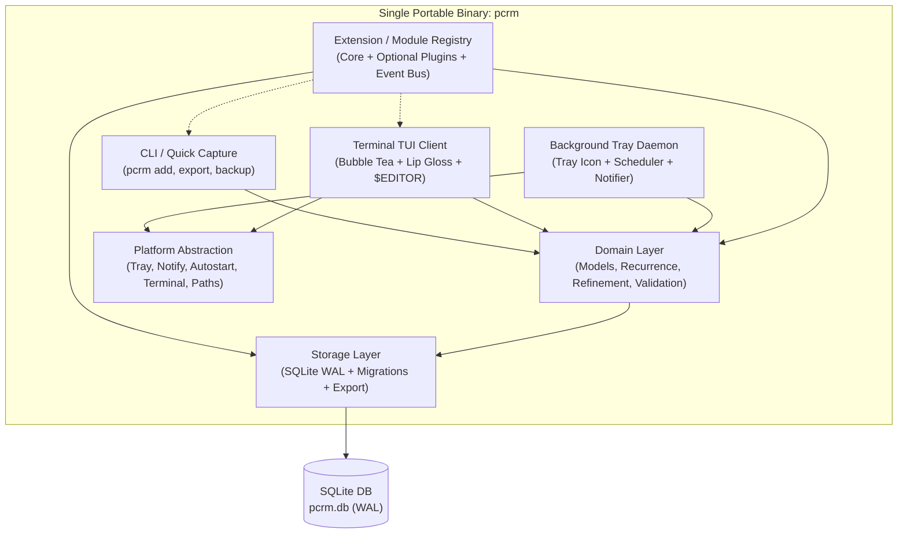

# PersonalCRM — Technical Architecture Blueprint

> **Status:** Approved Design Draft (Ready for Phase 2 Implementation)  
> **Stack:** Go + Bubble Tea + Pure-Go SQLite (`modernc.org/sqlite`)  
> **Last Updated:** 2026-11-24

---

## 1. High-Level System Topology

PersonalCRM ships as a **single portable binary** (`pcrm.exe` on Windows, `pcrm` on Linux/macOS) with three runtime modes sharing the same core domain, storage, and extension engine:



### Runtime Lifecycle (Single Binary, Daemon + TUI)
1. **Launching `pcrm` (no args):**
   - Checks if the background tray daemon is already running (via local single-instance lock + IPC endpoint).
   - If not running, spawns `pcrm daemon` detached in the background (with `CREATE_NO_WINDOW` on Windows so zero console flashes occur).
   - Opens the interactive Bubble Tea TUI in the current terminal.
   - Closing the TUI exits only the terminal client; the tray daemon continues running until **Quit** is clicked in the tray (or `pcrm daemon stop` is executed).
2. **Clicking Tray Icon or OS Notification:**
   - The daemon invokes `platform.TerminalLauncher` to open (or focus, if a TUI instance is already registered via IPC) a terminal window running `pcrm tui` (preferring Windows Terminal `wt.exe` if available, falling back to `conhost.exe` / PowerShell on Windows; configurable in `config.toml`).
   - Clicking a **Weekly Refinement** notification opens the TUI (`pcrm tui`); the Dashboard displays the prominent Refinement banner ready to launch with a single keystroke.
3. **CLI Quick Capture (`pcrm add ...`):**
   - Writes directly to SQLite (safe concurrent access via SQLite WAL mode + `busy_timeout`), emits domain events, and exits immediately in milliseconds without launching the TUI.

---

## 2. Windows Single-`.exe` Tray & Autostart Strategy

Because `pcrm.exe` is both an interactive console CLI/TUI and a background tray app:
- **Subsystem:** Compiled as a standard Windows console executable (`CGO_ENABLED=0`) so `pcrm`, `pcrm add`, and `pcrm tui` work natively in Windows Terminal, PowerShell, and `cmd.exe` with full stdin/stdout/ANSI support.
- **Spawning Daemon from CLI/TUI:** `exec.Command(selfPath, "daemon")` with `SysProcAttr{CreationFlags: CREATE_NO_WINDOW | DETACHED_PROCESS}` starts the daemon completely silently with zero window flash.
- **Windows Autostart (Zero Flash):**
  - Primary method: Register a current-user logon entry via Windows Task Scheduler (or `conhost.exe --headless <path>\pcrm.exe daemon` in `HKCU\Software\Microsoft\Windows\CurrentVersion\Run` on Windows 10/11 — zero UAC prompt, zero console flash, works cleanly for a portable `.exe`).
  - Fallback if `--headless` is unavailable: `FreeConsole()` immediately on `daemon` entry.
- **Portable Mode:**
  - If a `pcrm.portable` marker file (or `pcrm.db`) exists in the same directory as `pcrm.exe`, all data/config is stored beside the binary (`./data/`).
  - Otherwise, uses standard OS user directories (`%APPDATA%\PersonalCRM` on Windows, `~/.local/share/pcrm` + `~/.config/pcrm` on Linux, `~/Library/Application Support/PersonalCRM` on macOS).
  - Can also be overridden via `PCRM_DATA_DIR` or `--data-dir`.

---

## 3. Cross-Platform Abstraction (`internal/platform`)

All OS-dependent behavior is hidden behind small interfaces in `internal/platform` with Go build-tagged implementations (`_windows.go`, `_linux.go`, `_darwin.go`):

- **`Paths`**: Resolves portable vs. OS-standard data, config, log, and backup directories.
- **`Tray`**: Native system tray icon, tooltip, status badge/icon swap (e.g., dot/highlight when Refinement is due), and dynamic menu items (`Open PersonalCRM`, `Start Refinement` when due, `Autostart` checkmark, `Quit`).
  - *Windows/Linux:* `fyne.io/systray` (pure Go on Windows via Win32 DLL calls and pure Go on Linux via D-Bus SNI; macOS uses native AppKit when built on macOS).
- **`Notifier`**: Native OS toast/desktop notifications with optional click callback / launch action.
  - *Windows:* WinRT / Windows Toast notification (pure Go library or PowerShell/WinRT bridge).
  - *Linux:* `org.freedesktop.Notifications` over D-Bus (`godbus/dbus`).
  - *macOS:* `NSUserNotification` / `osascript` / `terminal-notifier`.
- **`Autostart`**: Enable/disable/query login autostart for the current executable path.
  - *Windows:* `HKCU\...\Run` with `conhost.exe --headless` (or Scheduled Task).
  - *Linux:* `~/.config/autostart/pcrm.desktop`.
  - *macOS:* `~/Library/LaunchAgents/com.personalcrm.daemon.plist`.
- **`TerminalLauncher`**: Launches or focuses a terminal window running `pcrm tui` (Windows: detects `wt.exe`, falls back to `cmd`/`conhost`; Linux: `$TERMINAL` / `x-terminal-emulator` / common terminals; macOS: Terminal.app / iTerm2).
- **`IPC`**: Local single-instance daemon lock & lightweight control channel (Windows Named Pipe `\\.\pipe\pcrm-daemon` or localhost loopback socket with random per-run auth token in data dir; Unix domain socket on Linux/macOS).

---

## 4. Pluggable Extension / Module Architecture (`internal/ext`)

Go does not support dynamic Go `plugin.Open` shared libraries on Windows, so PersonalCRM uses a **two-tier pluggable architecture** that works identically across all platforms:

### Tier 1: In-Process Pluggable Modules (Compiled-In, Config-Toggled)
Optional capabilities (**People**, **Reports**, **Markdown Sync**, etc.) implement a clean `ext.Module` interface and register themselves with the `ext.Registry`. Users enable or disable modules in `config.toml` (or inside TUI Settings):

```go
type Module interface {
    ID() string          // e.g. "people", "reports"
    Name() string        // Display name
    Description() string
    DefaultEnabled() bool

    // Lifecycle & Schema
    Migrations() []storage.Migration // Namespaced tables: ext_<id>_*
    Init(ctx ModuleContext) error    // Receives DB, EventBus, Logger, Config

    // Optional Capabilities (return nil if unused)
    TUIViews() []TUIViewProvider           // Extra top-level tabs or detail panels
    DashboardWidgets() []DashboardWidget   // Optional dashboard cards
    RefinementSteps() []RefinementStep     // Optional Weekly Refinement steps
    CLICommands() []*CLICommand            // Extra CLI subcommands
    ScheduledJobs() []ScheduledJob         // Background daemon jobs
}
```

### Tier 2: Polymorphic Core + Event Bus (Zero-Rewrite Foundation)
To ensure plugins feel like first-class citizens without touching core tables or services:
1. **Polymorphic Tables:** `entity_links`, `entity_tags`, and `progress_logs` reference `(entity_type, entity_id)` where `entity_type` is an open string (`project`, `idea`, `hobby`, `note`, `resource`, or any plugin type such as `person`).
   - Result: The moment a `people` plugin is enabled, Notes, Links, Tags, and Progress Logs immediately work with People without changing a single core table!
2. **Typed Event Bus:** Core services publish domain events (`project.created`, `project.status_changed`, `idea.promoted`, `task.completed`, `routine.completed`, `refinement.completed`). Plugins (such as `reports` or future webhooks/sync) subscribe cleanly without coupling.
3. **Future Out-of-Process Plugins (Tier 3 Ready):** If third-party external plugins are ever desired, the `ext.Registry` can load external executables matching `pcrm-ext-*` from `<data_dir>/plugins/` over a simple JSON-RPC stdin/stdout protocol, adapting them into the same `ext.Module` interface.

---

## 5. SQLite Data Schema (v1 Foundation)

- **Engine:** SQLite via `modernc.org/sqlite` (pure Go, zero CGO).
- **Pragmas on every connection:** `PRAGMA journal_mode=WAL;`, `PRAGMA foreign_keys=ON;`, `PRAGMA busy_timeout=5000;`.
- **Primary Keys:** ULIDs (`TEXT PRIMARY KEY`) — time-sortable, URL/CLI friendly, collision-free across exports/imports.
- **Timestamps:** RFC3339 UTC strings (`TEXT`).

### Core Tables (`0001_init.sql`)

```sql
-- Schema & Plugin Migrations
CREATE TABLE schema_migrations (
    namespace   TEXT NOT NULL,          -- 'core' or 'ext:<module_id>'
    version     INTEGER NOT NULL,
    applied_at  TEXT NOT NULL,
    PRIMARY KEY (namespace, version)
);

-- Projects
CREATE TABLE projects (
    id          TEXT PRIMARY KEY,
    title       TEXT NOT NULL,
    description TEXT NOT NULL DEFAULT '',
    goal        TEXT NOT NULL DEFAULT '',
    status      TEXT NOT NULL DEFAULT 'active'
                CHECK (status IN ('active', 'waiting', 'on_hold', 'finished', 'rejected')),
    priority    TEXT NOT NULL DEFAULT 'medium'
                CHECK (priority IN ('low', 'medium', 'high')),
    start_date  TEXT,
    target_date TEXT,
    finished_at TEXT,
    created_at  TEXT NOT NULL,
    updated_at  TEXT NOT NULL
);

-- Tasks / Next Actions (linked to Projects; project_id nullable for flexibility)
CREATE TABLE tasks (
    id               TEXT PRIMARY KEY,
    project_id       TEXT REFERENCES projects(id) ON DELETE CASCADE,
    title            TEXT NOT NULL,
    description      TEXT NOT NULL DEFAULT '',
    status           TEXT NOT NULL DEFAULT 'open'
                     CHECK (status IN ('open', 'in_progress', 'blocked', 'done', 'cancelled')),
    priority         TEXT NOT NULL DEFAULT 'medium'
                     CHECK (priority IN ('low', 'medium', 'high')),
    due_at           TEXT,
    reminder_enabled INTEGER NOT NULL DEFAULT 0,
    reminder_sent_at TEXT,
    position         INTEGER NOT NULL DEFAULT 0,
    completed_at     TEXT,
    created_at       TEXT NOT NULL,
    updated_at       TEXT NOT NULL
);

-- Ideas Tracker (serves as Inbox + Research Tracker)
CREATE TABLE ideas (
    id                  TEXT PRIMARY KEY,
    title               TEXT NOT NULL,
    description         TEXT NOT NULL DEFAULT '',
    status              TEXT NOT NULL DEFAULT 'inbox'
                        CHECK (status IN ('inbox', 'exploring', 'ready', 'parked', 'promoted', 'discarded')),
    source              TEXT NOT NULL DEFAULT '',
    excitement          INTEGER CHECK (excitement IS NULL OR (excitement BETWEEN 1 AND 5)),
    promoted_project_id TEXT REFERENCES projects(id) ON DELETE SET NULL,
    created_at          TEXT NOT NULL,
    updated_at          TEXT NOT NULL
);

-- Hobbies (Ongoing Interests, No Fixed End Target)
CREATE TABLE hobbies (
    id            TEXT PRIMARY KEY,
    name          TEXT NOT NULL,
    description   TEXT NOT NULL DEFAULT '',
    current_focus TEXT NOT NULL DEFAULT '',
    status        TEXT NOT NULL DEFAULT 'active'
                  CHECK (status IN ('active', 'on_hold', 'rejected')),
    created_at    TEXT NOT NULL,
    updated_at    TEXT NOT NULL
);

-- Routines (Simple Cycle-Resetting Checklist)
CREATE TABLE routines (
    id                  TEXT PRIMARY KEY,
    title               TEXT NOT NULL,
    description         TEXT NOT NULL DEFAULT '',
    schedule_type       TEXT NOT NULL
                        CHECK (schedule_type IN ('daily', 'weekly', 'monthly', 'every_n_days', 'weekdays')),
    schedule_config     TEXT NOT NULL DEFAULT '{}', -- JSON: {"interval_days":3,"anchor_date":"2026-11-24"} or {"weekdays":[1,3,5]}
    active              INTEGER NOT NULL DEFAULT 1,
    reminder_enabled    INTEGER NOT NULL DEFAULT 0,
    reminder_time       TEXT,                       -- Optional "HH:MM" local time
    completed_cycle_key TEXT,                       -- Active cycle identifier when checked off
    last_completed_at   TEXT,
    last_reminded_cycle TEXT,
    created_at          TEXT NOT NULL,
    updated_at          TEXT NOT NULL
);

-- Standalone Reusable Notes (Markdown content edited via $EDITOR)
CREATE TABLE notes (
    id          TEXT PRIMARY KEY,
    title       TEXT NOT NULL,
    content     TEXT NOT NULL DEFAULT '',
    source      TEXT NOT NULL DEFAULT '',
    created_at  TEXT NOT NULL,
    updated_at  TEXT NOT NULL
);

-- Standalone Reusable Resources & Links
CREATE TABLE resources (
    id            TEXT PRIMARY KEY,
    title         TEXT NOT NULL,
    url_or_path   TEXT NOT NULL,
    resource_type TEXT NOT NULL DEFAULT 'link'
                  CHECK (resource_type IN ('link', 'book', 'course', 'tool', 'file', 'other')),
    status        TEXT NOT NULL DEFAULT 'reference'
                  CHECK (status IN ('to_consume', 'in_progress', 'reference')),
    notes         TEXT NOT NULL DEFAULT '',
    created_at    TEXT NOT NULL,
    updated_at    TEXT NOT NULL
);

-- Polymorphic Many-to-Many Links (Notes <-> Ideas/Projects/Hobbies/Notes, Resources <-> Any, Idea <-> Hobby, Plugin entities)
CREATE TABLE entity_links (
    source_type   TEXT NOT NULL,
    source_id     TEXT NOT NULL,
    target_type   TEXT NOT NULL,
    target_id     TEXT NOT NULL,
    relation_type TEXT NOT NULL DEFAULT 'related', -- e.g. 'related', 'research', 'inspired_by'
    created_at    TEXT NOT NULL,
    PRIMARY KEY (source_type, source_id, target_type, target_id, relation_type)
);

-- Polymorphic Dated Progress / Reflection Logs (Projects, Hobbies, Future Plugins)
CREATE TABLE progress_logs (
    id          TEXT PRIMARY KEY,
    entity_type TEXT NOT NULL,
    entity_id   TEXT NOT NULL,
    logged_at   TEXT NOT NULL,
    content     TEXT NOT NULL,
    created_at  TEXT NOT NULL
);

-- Tags & Polymorphic Tagging
CREATE TABLE tags (
    id   TEXT PRIMARY KEY,
    name TEXT NOT NULL UNIQUE COLLATE NOCASE
);

CREATE TABLE entity_tags (
    entity_type TEXT NOT NULL,
    entity_id   TEXT NOT NULL,
    tag_id      TEXT NOT NULL REFERENCES tags(id) ON DELETE CASCADE,
    PRIMARY KEY (entity_type, entity_id, tag_id)
);

-- Weekly Refinement State & Run History
CREATE TABLE refinement_runs (
    id                TEXT PRIMARY KEY,
    cycle_key         TEXT NOT NULL,        -- e.g. "2026-W48"
    started_at        TEXT NOT NULL,
    completed_at      TEXT,
    projects_reviewed INTEGER NOT NULL DEFAULT 0,
    ideas_reviewed    INTEGER NOT NULL DEFAULT 0,
    routines_reviewed INTEGER NOT NULL DEFAULT 0,
    notes             TEXT NOT NULL DEFAULT ''
);

-- Key-Value App State (scheduler cursors, refinement due_since, snoozed_until, etc.)
CREATE TABLE app_state (
    key        TEXT PRIMARY KEY,
    value      TEXT NOT NULL,
    updated_at TEXT NOT NULL
);

-- Indexes for fast lookups
CREATE INDEX idx_tasks_project_status ON tasks(project_id, status);
CREATE INDEX idx_tasks_due ON tasks(due_at) WHERE status NOT IN ('done', 'cancelled');
CREATE INDEX idx_links_source ON entity_links(source_type, source_id);
CREATE INDEX idx_links_target ON entity_links(target_type, target_id);
CREATE INDEX idx_logs_entity ON progress_logs(entity_type, entity_id, logged_at DESC);
CREATE INDEX idx_entity_tags_lookup ON entity_tags(entity_type, entity_id);
```

---

## 6. Recurrence & Weekly Refinement Scheduling Engine (`internal/domain`)

### Routine Cycle Keys (Simple Resetting Checklist)
A pure deterministic function `ActiveCycle(routine, nowLocal)` computes `(isDueToday bool, cycleKey string)`:
- **`daily`:** `isDueToday = true`, `cycleKey = "2026-11-24"`
- **`weekly`:** `isDueToday = true` (due once per ISO week), `cycleKey = "2026-W48"`
- **`monthly`:** `isDueToday = true` (due once per calendar month), `cycleKey = "2026-11"`
- **`weekdays`:** `isDueToday = weekday(now) ∈ schedule.Weekdays`, `cycleKey = "2026-11-24"`
- **`every_n_days`:** `daysSinceAnchor = floor((date(now) - anchorDate) / 1 day)`; `cycleIndex = daysSinceAnchor / N`; `cycleKey = fmt.Sprintf("n%d:%s:%d", N, anchorDate, cycleIndex)`.

A routine is **checked off** for the current period iff `routine.CompletedCycleKey == cycleKey`. When a new cycle begins, the key naturally changes and the routine resets automatically — no cron reset job needed and completely resilient to missed days or PC downtime!

### Weekly Refinement & Opt-In Reminder Scheduler
- Runs inside the daemon on a lightweight 60-second ticker (plus immediate check on daemon startup for catch-up).
- **Weekly Refinement:**
  - Config: `refinement.weekday` (default `Sunday`), `refinement.time` (default `18:00`), `refinement.enabled` (default `true`).
  - Computes the most recent scheduled trigger timestamp `<= now`.
  - If that trigger is newer than `last_completed_at` and not snoozed (`now >= snoozed_until`):
    - Marks `refinement_due = true` in `app_state` (immediately visible as the Dashboard banner in the TUI and highlighted in the Tray menu).
    - Sends a native OS notification once per cycle (or again when snooze expires).
- **Opt-In Routine Reminders:**
  - If global `notifications.routines = true` and `routine.reminder_enabled = true`: when the routine is due, unchecked for `cycleKey`, `now >= reminder_time`, and `last_reminded_cycle != cycleKey`, sends a notification and records `last_reminded_cycle`.
- **Opt-In Task Deadline Reminders:**
  - If global `notifications.task_deadlines = true` and `task.reminder_enabled = true`: when `task.status` is open, `due_at` is within configured lead time (e.g., due today / 1 hour before), and `reminder_sent_at IS NULL`, sends a notification and stamps `reminder_sent_at`.

---

## 7. Planned Go Project Structure

```text
PersonalCRM/
├── AGENTS.md
├── .gitignore
├── go.mod
├── go.sum
├── docs/
│   ├── PROJECT_CONTEXT.md
│   ├── ARCHITECTURE.md
│   ├── MODULE_PEOPLE.md
│   ├── RUST_VS_GO.md
│   ├── TEST_PLAN.md
│   └── STATUS.md
├── cmd/
│   └── pcrm/
│       └── main.go              # CLI router: tui (default), daemon, add, export, backup, config
└── internal/
    ├── config/                  # TOML config loading, defaults, portable-mode detection
    ├── domain/                  # Core entities, status enums, recurrence math, refinement rules, events
    ├── storage/                 # SQLite connection, migrations, repositories, JSON/Markdown export
    ├── ext/                     # Module interface, Registry, EventBus, future modules/
    ├── editor/                  # External $EDITOR launcher (temp .md file -> read back)
    ├── tui/                     # Bubble Tea root model, Dashboard, Refinement wizard, entity views
    ├── daemon/                  # Tray lifecycle, scheduler loop, IPC server/client
    └── platform/                # OS interfaces + _windows.go, _linux.go, _darwin.go builds
```

---

## 8. Phased Implementation Plan

1. **Phase 2 — Project Bootstrap, Core Domain & SQLite Storage**
   - Initialize Go module, config loader (including portable mode), ULID helper, domain models, routine recurrence math, SQLite connection & `0001_init.sql` migrations, repositories, polymorphic linking, and comprehensive unit tests.
2. **Phase 3 — Extension Registry, Event Bus & CLI Quick Capture**
   - Build `internal/ext` registry & event bus, CLI commands (`pcrm add idea|task|note|link`, `pcrm export`, `pcrm backup`), and verify concurrent DB safety.
3. **Phase 4 — TUI Application (Bubble Tea)**
   - Build Dashboard (with Refinement banner + due routines + active projects), Projects & Tasks view, Ideas Tracker (with Promote-to-Project flow), Hobbies view, Routines view, Notes & Resources views (with many-to-many linking & external `$EDITOR` editing), Progress Logs, and the guided Weekly Refinement workflow.
4. **Phase 5 — Windows System Tray Daemon, Notifications & Autostart**
   - Implement `internal/platform` Windows backend (tray icon, toast notifications, flicker-free daemon spawn, autostart toggle, Windows Terminal launcher, IPC), wire scheduler (Weekly Refinement + opt-in Routine & Task reminders), and produce the portable `pcrm.exe` release build.
5. **Phase 6 — Cross-Platform Backends & First Extensions**
   - Add Debian Linux and macOS backends in `internal/platform`, plus initial optional modules (e.g., `people`, `reports`).
